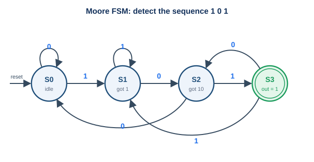

# Example: a Markdown reading

Markdown readings are good for **notes, cheat sheets and short guides** that are easy to edit.

## A table

| Signal | Direction | Meaning |
|---|---|---|
| `clk` | in | clock, rising edge active |
| `rst` | in | synchronous reset |
| `q[3:0]` | out | register content |

## A picture



## Code

```systemverilog
always_ff @(posedge clk)
  if (rst) q <= '0;
  else     q <= {q[2:0], d_in};
```

> Images live next to this file (`images/`), so the checker can pack them.
